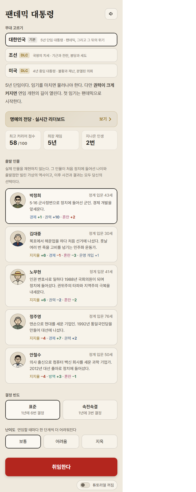

<p align="center"></p>

<h1 align="center">팬데믹 대통령</h1>

<p align="center">위기 속에서 고른 선택이 한 사람의 정치 인생이 되는 브라우저 게임<br>
<b><a href="https://csmsm0518.github.io/pandemic-president/">▶ 지금 플레이하기</a></b> · <a href="https://csmsm0518.github.io/pandemic-president/leaderboard.html">명예의 전당</a></p>

<p align="center"></p>

---

## 어떤 게임인가요

팬데믹 한가운데 취임한 대통령이 되어 5년 동안 사건마다 선택을 합니다. 선택이 **권력 집중**과 **견제·분산** 중 어디로 기우는지가 쌓여 결말, 닮은 역사 속 지도자, 커리어 점수가 정해집니다.

- 대한민국 본편 + DLC(조선 · 미국 등), 난이도 쉬움 · 보통 · 어려움 · 지옥
- 참모 회의, 특별 국정 과제, 올림픽 · 백신 슬래시 같은 미니게임
- 실시간 대결(2~4명), 명예의 전당(닉네임과 점수만 공개)
- 휴대폰 · 태블릿 · PC 브라우저 어디서나, 설치 없이 바로

## 앱처럼 설치하기

한 번 설치하면 홈 화면 아이콘으로 바로 열리고, 인터넷이 잠깐 끊겨도 마지막으로 연 화면이 뜹니다.

| 기기 | 방법 |
|---|---|
| 안드로이드 (크롬 · 삼성 인터넷) | 게임 주소를 연 뒤 메뉴(⋮ 또는 ≡) → **앱 설치** 또는 **홈 화면에 추가** |
| 아이폰 · 아이패드 (사파리) | 아래 공유 버튼 → **홈 화면에 추가** |
| PC (크롬 · 엣지) | 주소창 오른쪽의 설치 아이콘(⊕) → **설치** |

## 폴더 구조

```
index.html · game.js · game.css · lazy/   ← python build.py 가 만드는 결과물 (직접 고치지 않기)
src/                 ← 게임 코드는 여기서 고친다 (자세한 설명: src/README.md)
  shell.html         화면 기본 틀
  js/                처음부터 받는 코드 (파일 이름 순서대로 합쳐짐)
  css/               처음부터 받는 디자인
  lazy/<이름>/        필요할 때 받는 조각 (미니게임 · 가이드북 · 명예의 전당 · 대결 …)
audio/               배경음악 · 효과음 mp3
icons/               로고와 앱 아이콘
guide/               가이드북 그림
leaderboard.html     명예의 전당 (따로 여는 페이지)
zombie.html          비밀 게임 '방역선 · 새벽까지'
manifest.webmanifest · sw.js   홈 화면 설치(웹앱)
apps-script.gs       기록 · 순위 서버 (Google Apps Script에 붙여 넣어 배포)
firebase-rules.json  실시간 대결 DB 규칙 (Firebase 콘솔에 게시)
build.py · tools/    빌드 도구
DESIGN.md · PRODUCT.md   디자인 · 제품 기준
CLAUDE.md            AI 도우미(Claude 등)가 이 저장소에서 일할 때 먼저 읽는 안내
```

## 직접 고쳐서 돌려 보기

파이썬 3만 있으면 됩니다(추가 설치 없음).

```bash
python build.py            # src/ 를 합쳐 index.html · game.js · game.css · lazy/ 만들기
python build.py --check    # 만든 파일이 src/ 와 맞는지 확인 (커밋 전에)
python -m http.server 8000 # 그다음 브라우저에서 http://localhost:8000
```

`main` 브랜치에 올리면 GitHub Pages가 그대로 게임 주소에 반영합니다.

## 음악에 대해

`audio/` 의 배경음악은 각 곡의 저작권자에게 권리가 있습니다(곡 이름과 아티스트는 음악이 나올 때 게임 화면에 표시됩니다). 아래 MIT 라이선스는 **이 저장소의 코드에만** 적용되고, 음악 파일에는 적용되지 않습니다.

## 라이선스

코드는 [MIT License](./LICENSE)를 따릅니다. **게임의 기획 · 디자인 · 원본 코드는 모두 [@csmsm0518](https://github.com/csmsm0518)의 것입니다.**

## 만든 사람 (Contributors)

- [@csmsm0518](https://github.com/csmsm0518) — 원작자 · 게임 기획, 디자인, 코드 전부
- [@kraewon7422](https://github.com/kraewon7422) — 저장소 정리, 버그 수정, 로고 · 웹앱 설치

---

## English

**Pandemic President** is a browser game where you play one politician's career through a pandemic: every crisis choice leans toward concentrating power or toward checks and balances, and that decides your ending, the historical leader you resemble, and your career score.

- **Play:** https://csmsm0518.github.io/pandemic-president/ — works on phone, tablet and desktop; installable as an app (browser menu → *Install app* / *Add to Home Screen*).
- **Develop:** edit files in `src/`, then run `python build.py` (generated files: `index.html`, `game.js`, `game.css`, `lazy/`). See `src/README.md` and `CLAUDE.md`.
- **License:** code is MIT. All original game design and code by [@csmsm0518](https://github.com/csmsm0518). Music in `audio/` belongs to its respective copyright holders and is not covered by the MIT license.
